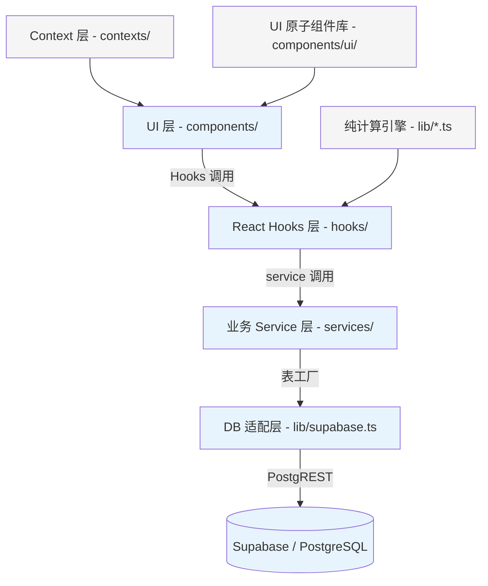
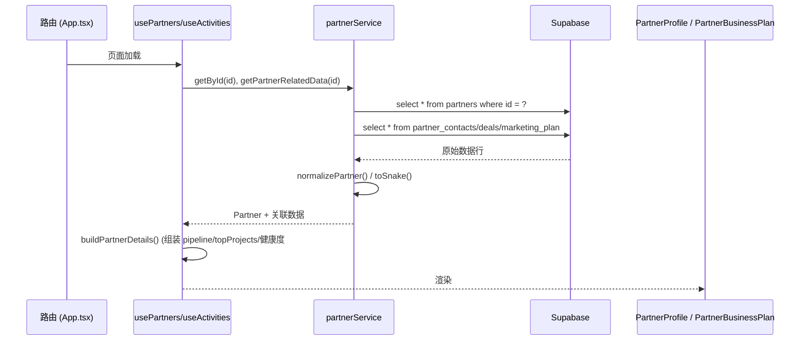
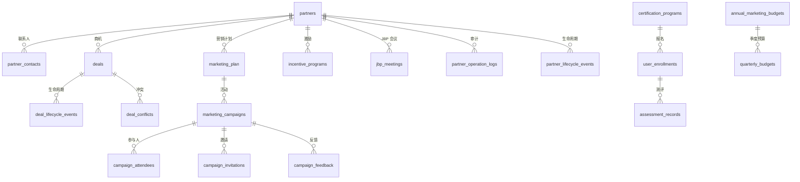

# 合作伙伴管理系统 - 架构与业务逻辑设计文档

> 生成日期：2026-06-23
> 适用版本：partner-management-1-main
> 文档用途：为开发者 / 产品经理 / 运维人员提供整体架构认知与关键模块说明

---

## 一、技术栈与项目结构

### 1.1 核心技术栈

| 分类 | 技术选型 | 版本 | 说明 |
|------|----------|------|------|
| 前端框架 | React | 19.x | 声明式组件，函数组件 + Hooks |
| 构建工具 | Vite | 8.x | 快速构建、HMR |
| 路由 | react-router-dom | 7.x | 声明式路由 + 代码分割 |
| 样式 | Tailwind CSS | 4.x | 原子化 CSS |
| 图表可视化 | Recharts / D3 | 3.x / 7.x | 业务指标、KPI、关系图 |
| 数据库 + 端数据库 | Supabase (PostgreSQL) | - | BaaS，提供实时数据与认证 |
| AI 能力 | @ai-sdk/openai + @google/genai | - | 智能分析 / 内容生成 / 视觉识别 |
| 语言 | TypeScript | ~5.8 | 完整类型系统 |
| 端侧小程序 | 微信原生小程序 | - | 签到 / 活动 / 积分 |
| E2E 测试 | Playwright | 1.x | 关键业务流程自动化验证 |

*代码参考：[package.json](file:///Users/haifangzhao/Documents/202606/partner-management-1-main/package.json)*

### 1.2 目录结构总览

```
partner-management-1-main/
├── src/
│   ├── App.tsx                      # 路由入口（根组件 + Context 统一包裹
│   ├── main.tsx                        # 渲染入口
│   ├── components/
│   │   ├── auth/                       # 登录页 + AuthGuard
│   │   ├── dashboard/                  # 生态驾驶舱、KPI、战略矩阵、能力图谱
│   │   ├── partners/                   # 伙伴列表、档案、JBP、健康雷达、员工管理
│   │   ├── deals/                      # 商机报备、看板、健康巡检、客户分析
│   │   ├── marketing/                  # 营销、激励、MDF、预算、培训
│   │   ├── marketing/enablement/             # 培训课程、反馈、积分商店
│   │   ├── layout/                     # Sidebar / TopNav / NotFound
│   │   ├── ui/                         # 通用组件库
│   │   ├── admin/                      # 评分配置后台
│   │   └── debug/                     # 数据迁移调试页
│   ├── services/                       # 业务服务层
│   ├── hooks/                          # 自定义 Hooks
│   ├── lib/                           # 纯 TS 计算引擎
│   ├── contexts/                      # Auth/Config/Language/Theme 全局状态
│   ├── data/                          # 种子数据
│   └── config/                        # 常量配置
├── miniprogram/                      # 微信小程序（签到 / 活动 / 积分 / 个人中心
├── scripts/                          # 数据库迁移 & 种子脚本
├── api/ai/                           # AI 服务代理
└── docs/                             # 产品 PRD 与本架构文档
```

---

## 二、整体分层架构

### 2.1 分层图



### 2.2 各层职责说明

| 层级 | 目录 | 职责 |
|------|------|------|
| **UI 层** | `src/components/` | 页面组件与通用组件库，负责业务页面渲染与交互 |
| **Hooks 层** | `src/hooks/` | 将 service 数据封装为 React 状态，提供刷新与订阅语义 |
| **Service 层** | `src/services/` | 业务 CRUD、聚合统计、审计日志、规范化 (snake↔camel) |
| **DB 适配层** | `src/lib/supabase.ts` | Supabase 客户端初始化 + 50+ 张表工厂方法 |
| **Context 层** | `src/contexts/` | 全局状态（登录态、配置、多语言、主题） |
| **引擎层** | `src/lib/*.ts` | 纯 TS 计算（健康评估、ROI、阶段概率、Excel 导入） |

### 2.3 路由与页面组织

[App.tsx](file:///Users/haifangzhao/Documents/202606/partner-management-1-main/src/App.tsx) 作为应用根组件，自顶向下包裹：

```
ThemeProvider → ConfigProvider → AuthProvider → LanguageProvider → ToastProvider
   └─ BrowserRouter
        ├─ /login
        ├─ /ecosystem（生态驾驶舱，首页）
        ├─ /partners（伙伴列表 / 新增 / 详情）
        ├─ /partners/:id（伙伴档案 + JBP + 商机关联）
        ├─ /partners/:id/staff（伙伴员工管理）
        ├─ /deals（商机列表与看板）
        ├─ /deals/health-inspection（商机健康巡检）
        ├─ /deals/new、/deals/:id/edit
        ├─ /marketing（营销主页）
        ├─ /marketing/campaigns/:id（营销活动详情）
        ├─ /marketing/budget（预算管理）
        ├─ /incentives（激励计划）
        ├─ /enablement（培训/赋能）
        ├─ /channels（渠道仪表盘）
        ├─ /analytics（数据分析）
        ├─ /settings（系统设置）
        ├─ /admin/scoring（评分配置）
        ├─ /migrate（迁移调试）
        └─ /invitation/:code（活动邀请落地页）
```

*设计要点：
- **代码分割**：90% 页面通过 `retryableLazy()` 动态导入，降低首屏 bundle size 并增加加载失败重试；
- **统一 Layout**：Sidebar + TopNav + 主内容区；
- **错误隔离**：每个路由被 `ErrorBoundary` 独立包裹，配合 `NetworkStatus` 提示 DB 连接状态；
- **守卫**：`AuthGuard` 控制登录态访问。

---

## 三、核心业务模块

### 3.1 模块关系图

```mermaid
flowchart LR
    P[伙伴管理 Partners] -->|产生| D[商机管理 Deals]
    P -->|参与| M[营销 Marketing]
    P -->|达成| I[激励 Incentives]
    P -->|成长| E[赋能 Enablement]
    D -->|产出| Dash[驾驶舱 Dashboard]
    M -->|产出| Dash
    I -->|产出| Dash
    E -->|产出| Dash
    P -.-> A[审计日志 / 生命周期事件
    D -.-> A
    M -.-> A
```

### 3.2 伙伴管理（Partners）

**功能矩阵**

| 功能 | 主要文件 | 说明 |
|------|----------|------|
| 伙伴列表 | [PartnerList.tsx](file:///Users/haifangzhao/Documents/202606/partner-management-1-main/src/components/partners/PartnerList.tsx) | 地区/等级/状态过滤、卡片/地图视图、Excel 导入 |
| 伙伴档案 | [PartnerProfile.tsx](file:///Users/haifangzhao/Documents/202606/partner-management-1-main/src/components/partners/PartnerProfile.tsx) | 基础信息、健康雷达、诊断、商机关联、时间轴 |
| 健康雷达 | [PartnerHealthRadar.tsx](file:///Users/haifangzhao/Documents/202606/partner-management-1-main/src/components/partners/PartnerHealthRadar.tsx) | 5~7 维评分（活跃、商机、培训、合规、营收...） |
| 健康度条 | [PartnerHealthBar.tsx](file:///Users/haifangzhao/Documents/202606/partner-management-1-main/src/components/partners/PartnerHealthBar.tsx) | 百分比条展示 |
| 诊断面板 | [DiagnosisPanel.tsx](file:///Users/haifangzhao/Documents/202606/partner-management-1-main/src/components/partners/DiagnosisPanel.tsx) | 自动问题定位 |
| 新增/编辑 | [PartnerFormPage.tsx](file:///Users/haifangzhao/Documents/202606/partner-management-1-main/src/components/partners/PartnerFormPage.tsx) | 资质等级、合作范围、供应商匹配、联系人、商机 |
| JBP 联合业务计划 | [PartnerBusinessPlan.tsx](file:///Users/haifangzhao/Documents/202606/partner-management-1-main/src/components/partners/PartnerBusinessPlan.tsx) | 季度/年度合作计划 |
| 智能任务中心 | [SmartTaskCenter.tsx](file:///Users/haifangzhao/Documents/202606/partner-management-1-main/src/components/partners/SmartTaskCenter.tsx) | 基于健康度的自动任务建议 |
| 员工/积分管理 | [PartnerStaffPage.tsx](file:///Users/haifangzhao/Documents/202606/partner-management-1-main/src/components/partners/PartnerStaffPage.tsx) | 员工账号、活动记录、客户清单、项目清单 |

**业务服务**：[partner-service.ts](file:///Users/haifangzhao/Documents/202606/partner-management-1-main/src/services/partner-service.ts)

**关键业务流程**：`partnerService.create()` 原子操作顺序：
1. 写入 `partners` 主表（`id = crypto.randomUUID()）；
2. 遍历 `contacts` 写入 `partner_contacts`；
3. 遍历 `opportunities` 写入 `deals`（`source = 'PartnerCreation'`，默认 6 个月保护期；
4. 调用 `logOp()` 记录审计日志。

字段兼容策略：DB snake_case ↔ TS camelCase 双向映射表工厂在 `partnerService.toSnake()` 与 `normalizePartner()` 自动完成。

### 3.3 商机管理（Deals）

| 功能 | 主要文件 | 说明 |
|------|----------|------|
| 商机报备 | [DealRegistrationPage.tsx](file:///Users/haifangzhao/Documents/202606/partner-management-1-main/src/components/deals/DealRegistrationPage.tsx) | 客户信息、金额、产品、伙伴、销售员、冲突检查 |
| 看板视图 | [KanbanBoard.tsx](file:///Users/haifangzhao/Documents/202606/partner-management-1-main/src/components/deals/KanbanBoard.tsx) | Registered → Solution → Commercial → ClosedWon 阶段拖拽 |
| 健康巡检 | [DealHealthInspectionPage.tsx](file:///Users/haifangzhao/Documents/202606/partner-management-1-main/src/components/deals/DealHealthInspectionPage.tsx) | 基于 dealHealthEngine 的多维健康评分 |
| 赢/失因分析 | [WinLossPanel.tsx](file:///Users/haifangzhao/Documents/202606/partner-management-1-main/src/components/deals/components/WinLossPanel.tsx) | 标签 + 竞争对手 + 关键因素 |
| 规则引擎 | [RuleEnginePanel.tsx](file:///Users/haifangzhao/Documents/202606/partner-management-1-main/src/components/deals/components/RuleEnginePanel.tsx) | 自定义保护/审批规则 |
| 客户分析 | [CustomerAnalysis.tsx](file:///Users/haifangzhao/Documents/202606/partner-management-1-main/src/components/deals/CustomerAnalysis.tsx) | 单一客户维度聚合 |
| 商机详情 | [DealDetailPage.tsx](file:///Users/haifangzhao/Documents/202606/partner-management-1-main/src/components/deals/DealDetailPage.tsx) | 生命周期事件、下一步动作、跟进记录 |

**核心计算**（[lib/dealStageCalc.ts](file:///Users/haifangzhao/Documents/202606/partner-management-1-main/src/lib/dealStageCalc.ts) + [lib/dealHealthEngine.ts](file:///Users/haifangzhao/Documents/202606/partner-management-1-main/src/lib/dealHealthEngine.ts)：
- 每阶段历史平均周期（probability、avgCycleDays）；
- 停滞判定：`daysInCurrentStage > avgDays * 2`；
- 加权价值：`value * probability`；
- 健康度分：响应速度、赢率、保护期、冲突、阶段合理性的综合。

### 3.4 营销与激励（Marketing & Incentives）

**营销**

| 功能 | 主要文件 | 说明 |
|------|----------|------|
| 营销计划 | [MarketingPlanPage.tsx](file:///Users/haifangzhao/Documents/202606/partner-management-1-main/src/components/marketing/MarketingPlanPage.tsx) | 活动阶段任务清单 |
| 活动管理 | [CampaignManagementPage.tsx](file:///Users/haifangzhao/Documents/202606/partner-management-1-main/src/components/marketing/CampaignManagementPage.tsx) | 线上/线下/会议/培训 |
| 预算管理 | [BudgetManagementPage.tsx](file:///Users/haifangzhao/Documents/202606/partner-management-1-main/src/components/marketing/BudgetManagementPage.tsx) | 年度/季度/分类预算执行监控 |
| 渠道营销 | [ChannelDashboard.tsx](file:///Users/haifangzhao/Documents/202606/partner-management-1-main/src/components/marketing/ChannelDashboard.tsx) | 伙伴发起的营销活动 |
| ROI 分析 | [CampaignROIPanel.tsx](file:///Users/haifangzhao/Documents/202606/partner-management-1-main/src/components/marketing/CampaignROIPanel.tsx) | 投入 vs 签约金额 |
| MDF/PMDF | [MDFModule.tsx](file:///Users/haifangzhao/Documents/202606/partner-management-1-main/src/components/marketing/MDFModule.tsx) | 市场开发基金申请/审批/核销 |
| 邀请/签到 | [InvitationPage.tsx](file:///Users/haifangzhao/Documents/202606/partner-management-1-main/src/components/marketing/InvitationPage.tsx) | 二维码邀请 + 小程序签到 |
| 成长实验室 | [GrowthLabCockpits.tsx](file:///Users/haifangzhao/Documents/202606/partner-management-1-main/src/components/marketing/GrowthLabCockpits.tsx) | 伙伴成长漏斗 |

**激励**

| 功能 | 主要文件 | 说明 |
|------|----------|------|
| 激励计划 | [IncentivesPage.tsx](file:///Users/haifangzhao/Documents/202606/partner-management-1-main/src/components/marketing/IncentivesPage.tsx) | 按达成率/新客户数/销售额计算返利 |
| 激励政策 | [IncentivePolicyPage.tsx](file:///Users/haifangzhao/Documents/202606/partner-management-1-main/src/components/marketing/IncentivePolicyPage.tsx) | 规则模板 |
| 激励结算 | [IncentiveClosingDashboard.tsx](file:///Users/haifangzhao/Documents/202606/partner-management-1-main/src/components/marketing/IncentiveClosingDashboard.tsx) | 对账与结算 |

### 3.5 赋能培训（Enablement）

| 功能 | 文件 | 说明 |
|------|------|------|
| 课程目录 | [CourseCatalog.tsx](file:///Users/haifangzhao/Documents/202606/partner-management-1-main/src/components/marketing/enablement/CourseCatalog.tsx) | 课程列表、详情、学习进度 |
| 课程排名 | [CourseRanking.tsx](file:///Users/haifangzhao/Documents/202606/partner-management-1-main/src/components/marketing/enablement/CourseRanking.tsx) | 完成率、平均分排名 |
| AI 标签 | [aiTags.ts](file:///Users/haifangzhao/Documents/202606/partner-management-1-main/src/components/marketing/enablement/aiTags.ts) | 自动打技能标签 |
| 反馈分析 | [FeedbackAnalysis.tsx](file:///Users/haifangzhao/Documents/202606/partner-management-1-main/src/components/marketing/enablement/FeedbackAnalysis.tsx) | 评价文本雷达对比分析 |
| 积分商店 | [PointsStore.tsx](file:///Users/haifangzhao/Documents/202606/partner-management-1-main/src/components/marketing/enablement/PointsStore.tsx) | 培训积分兑换 |
| 学员洞察 | [CompanyView.tsx](file:///Users/haifangzhao/Documents/202606/partner-management-1-main/src/components/marketing/enablement/CompanyView.tsx) | 按伙伴维度查看学习完成情况 |

### 3.6 生态驾驶舱（Dashboard）

| 功能 | 文件 | 说明 |
|------|------|------|
| 首页主驾驶舱 | [EcosystemDashboard.tsx](file:///Users/haifangzhao/Documents/202606/partner-management-1-main/src/components/dashboard/EcosystemDashboard.tsx) | KPI、区域分布、漏斗、健康度一体化 |
| KPI 卡片 | [KpiCard.tsx](file:///Users/haifangzhao/Documents/202606/partner-management-1-main/src/components/dashboard/KpiCard.tsx) | 可复用指标卡（含同环比） |
| PipelineBoard | [PipelineBoard.tsx](file:///Users/haifangzhao/Documents/202606/partner-management-1-main/src/components/dashboard/PipelineBoard.tsx) | 商机漏斗、加权值、周期 |
| 战略矩阵 | [StrategicMatrix.tsx](file:///Users/haifangzhao/Documents/202606/partner-management-1-main/src/components/dashboard/StrategicMatrix.tsx) | 区域 × 行业二维矩阵 |
| 季度运营指挥塔 | [QuarterlyOpsControlTower.tsx](file:///Users/haifangzhao/Documents/202606/partner-management-1-main/src/components/dashboard/QuarterlyOpsControlTower.tsx) | 季度运营关键指标 |
| 能力图谱引擎 | [CapabilityGraphEngine.tsx](file:///Users/haifangzhao/Documents/202606/partner-management-1-main/src/components/dashboard/CapabilityGraphEngine.tsx) | 基于 D3 的能力图谱 |
| 历史趋势图 | [HistoricalTrendChart.tsx](file:///Users/haifangzhao/Documents/202606/partner-management-1-main/src/components/dashboard/HistoricalTrendChart.tsx) | 历史趋势线图 |

---

## 四、数据流与关键设计模式

### 4.1 数据流（以伙伴详情页为例）



### 4.2 字段命名兼容（snake_case ↔ camelCase）

`partnerService` 与 `dealService` 均内置双向映射：

```ts
// 写入数据库 → 前端 → 前端
// toSnake():  TS → 数据库列名
normalizePartner(): 数据库行 → TS 对象，补齐默认值
```

**效果**：PostgreSQL 统一 snake_case，TypeScript 统一 camelCase，老字段（industry）与新字段（industries 数组）共存，自动推断。

### 4.3 审计日志（Audit Logging）

`partnerService.logOp()` 写入 `partner_operation_logs`：

| 字段 | 含义 |
|------|------|
| partner_id | 伙伴 ID |
| action | create / edit / approve / reject / delete |
| operator | 操作者 |
| details | JSONB，变更字段快照 |

### 4.4 生命周期追踪（Lifecycle Tracker）

- UI 侧：`components/LifecycleTracker.tsx`；
- Service 侧：`services/lifecycle-service.ts`；
- 表：`partner_lifecycle_events` / `deal_lifecycle_events` / `incentive_program_lifecycle_events` / `training_lifecycle_events` / `marketing_lifecycle_events`。

### 4.5 权限系统

- `services/permission-service.ts` + `hooks/usePermission.ts`；
- 角色：admin / 运营 / 销售 / 伙伴管理员；
- 控制菜单、按钮、数据可见范围。

### 4.6 组件设计

`src/components/ui/` 定义完整 UI 原子组件库：Button、Card、Table、Modal、Toast、Tabs、DropdownMenu、AIPanel、VisionPanel、RegionCascader… 通过 `index.ts` 聚合。

### 4.7 AI 能力集成

- `services/ai-service.ts`：调用 OpenAI / Google GenAI 做智能诊断、生成报告；
- `components/ui/AIPanel.tsx` + `VisionPanel.tsx`：AI 对话 + 视觉识别；
- `api/ai/query.js` + `api/ai/vision.js`：服务端代理（规避浏览器 CORS、隐藏 API Key）。

### 4.8 微信小程序

`miniprogram/` 是独立的微信小程序：

| 页面 | 功能 |
|------|------|
| pages/checkin | 扫码签到 |
| pages/event | 活动详情 |
| pages/score | 积分查询与兑换 |
| pages/store | 积分商品兑换 |
| pages/profile | 个人中心 |
| utils/api.js + utils/auth.js | 与后台 Supabase 对接 |

---

## 五、数据库与种子脚本

### 5.1 数据库 ER 草图（核心表）



### 5.2 表分类清单

| 表名前缀 | 业务域 |
|-----------|--------|
| `partner_*` | 伙伴主数据、联系人、操作日志、JBP、生命周期 |
| `deal_*` | 商机、生命周期、冲突、活动 |
| `marketing_*` | 计划、活动、预算、邀请、反馈 |
| `campaign_*` | 报名、注册、积分、任务、问题 |
| `incentive_*` | 计划、模板、申请、预算告警 |
| `certification_*` | 课程、报名、测评、反馈 |
| `*_lifecycle_events` | 各实体生命周期事件 |

### 5.3 迁移与种子脚本

- **表结构迁移**：`scripts/run-migration.*`、`scripts/db-migration-marketing.cjs`、`scripts/run-optimization-migration.cjs`
- **种子数据**：`scripts/seed-*.js` + `seed-final.py`
- **SQL 脚本**：`LIFECYCLE_COMPLETE_SQL.sql`、`ONE_CLICK_MIGRATION.sql`、`seed-all-data.sql` 可直接在 Supabase SQL Editor 执行
- **调试页**：`components/debug/RunMigration.tsx`（路由 `/migrate`），UI 内触发迁移

---

## 六、部署与集成

### 6.1 构建

```bash
npm run dev     # 本地开发 (Vite HMR)
npm run build   # 生产构建 → dist/
npm run lint   # TS 类型检查
npm run preview # 预览构建产物
```

### 6.2 部署路径

- **Vercel**：`scripts/deploy-vercel.cjs`
- **自建服务器**：`scripts/deploy-server.sh` / `deploy.py` / `deploy_try_all.py`
- **CI/CD**：`.github/workflows/deploy.yml`
- **简易服务端**：`server.js`（Express 风格，代理 `api/ai/*`、邮件触发）

### 6.3 环境变量

`/env.example` 示例：

| 变量 | 用途 |
|------|------|
| `VITE_SUPABASE_URL` | Supabase 项目 URL |
| `VITE_SUPABASE_ANON_KEY` | Supabase 匿名 Key |
| AI Keys | 用于 ai-service 调用 |

### 6.4 E2E 测试

`e2e/*.spec.ts` 覆盖：登录、伙伴登记、商机报备、健康巡检、营销活动。

---

## 七、核心 Hooks 一览

| Hook | 文件 | 产出 |
|------|------|------|
| `usePartners()` | [hooks/useData.ts](file:///Users/haifangzhao/Documents/202606/partner-management-1-main/src/hooks/useData.ts) | 伙伴列表 + 跨组件引用 ref |
| `useDeals()` | [hooks/useData.ts](file:///Users/haifangzhao/Documents/202606/partner-management-1-main/src/hooks/useData.ts) | 商机、聚合统计、refreshDeals() |
| `useActivities()` | [hooks/useData.ts](file:///Users/haifangzhao/Documents/202606/partner-management-1-main/src/hooks/useData.ts) | 操作日志 + JBP 合并 |
| `useMarketingData()` | [hooks/useData.ts](file:///Users/haifangzhao/Documents/202606/partner-management-1-main/src/hooks/useData.ts) | MDF、激励聚合 |
| `useDashboardStats()` | [hooks/useData.ts](file:///Users/haifangzhao/Documents/202606/partner-management-1-main/src/hooks/useData.ts) | 活跃、pipeline、转化率 |
| `useMatrixData()` | [hooks/useData.ts](file:///Users/haifangzhao/Documents/202606/partner-management-1-main/src/hooks/useData.ts) | 区域 × 行业矩阵 |
| `useCockpitData()` | [hooks/useData.ts](file:///Users/haifangzhao/Documents/202606/partner-management-1-main/src/hooks/useData.ts) | 驾驶舱完整数据（月/季/年对比） |
| `usePermission()` | [hooks/usePermission.ts](file:///Users/haifangzhao/Documents/202606/partner-management-1-main/src/hooks/usePermission.ts) | 角色权限检查 |
| `useDealHealth()` | [hooks/useDealHealth.ts](file:///Users/haifangzhao/Documents/202606/partner-management-1-main/src/hooks/useDealHealth.ts) | 商机健康评估 |
| `useHealthData()` | [hooks/useHealthData.ts](file:///Users/haifangzhao/Documents/202606/partner-management-1-main/src/hooks/useHealthData.ts) | 伙伴健康评估 |
| `useAsync()` | [hooks/useAsync.ts](file:///Users/haifangzhao/Documents/202606/partner-management-1-main/src/hooks/useAsync.ts) | 通用异步 Hook |

---

## 八、关键计算引擎（lib/）

| 文件 | 职责 |
|------|------|
| `partnerHealthEngine.ts` | 伙伴健康度多维度评分（活跃、商机、培训、合规、营收） |
| `dealHealthEngine.ts` | 商机健康度（停滞、保护期、赢率、冲突、响应速度） |
| `marketingROIEngine.ts` | 营销投入-产出 ROI 分析 |
| `dealStageCalc.ts` | 商机阶段概率、平均周期、加权值 |
| `partnerDataBuilder.ts` | DB raw partner → UI PartnerDetails |
| `excelImport.ts` | Excel 导入解析（伙伴 / 商机） |
| `realCockpitData.ts` | 驾驶舱真实数据聚合（月/季/年对比、同环比） |
| `regionData.ts` | 省市区三级数据 |
| `retryableLazy.ts` | 带重试的 React.lazy 封装（网络抖动防护） |
| `supabase.ts` | Supabase 客户端 + 50+ 表工厂 |

---

## 九、关键工程特征总结

| 特征 | 说明 |
|------|------|
| **分层清晰** | UI → Hooks → Services → DB Adapter → Supabase |
| **类型严格** | 全量 TS，Partner/Deal 等业务实体完整类型定义 |
| **健壮容错** | Supabase 失败走空数据；ErrorBoundary 包裹各路由；`retryableLazy()` 重试组件加载 |
| **可扩展** | 新增表：`supabase.ts` 的 `db` 对象加一行工厂方法；新增模块：service + hook + 页面 + 路由注册 |
| **可观测** | 审计日志统一入口、生命周期事件可追溯、业务合规审计 |
| **代码分割** | 业务页面动态导入，降低首屏 bundle size |
| **字段兼容** | snake_case ↔ camelCase 双向映射，平滑迁移 |

---

## 十、扩展阅读

- 产品理论：[theory-one-pager.html](file:///Users/haifangzhao/Documents/202606/partner-management-1-main/docs/theory-one-pager.html)
- 架构图（HTML）：[architecture-diagram.html](file:///Users/haifangzhao/Documents/202606/partner-management-1-main/docs/architecture-diagram.html)
- 代码评审清单：[CODE_REVIEW.md](file:///Users/haifangzhao/Documents/202606/partner-management-1-main/docs/CODE_REVIEW.md)
- 营销页面架构：[市场营销首页_页面架构与业务逻辑设计文档.md](file:///Users/haifangzhao/Documents/202606/partner-management-1-main/docs/%E5%B8%82%E5%9C%BA%E8%90%A5%E9%94%80%E9%A6%96%E9%A1%B5_%E9%A1%B5%E9%9D%A2%E6%9E%B6%E4%B8%9A%E5%8A%A1%E9%80%BB%E8%BE%91%E8%AE%BE%E8%AE%A1%E6%96%87%E6%A1%A3.md)
- 预算规划：[年度营销预算规划_页面架构与业务逻辑设计文档.md](file:///Users/haifangzhao/Documents/202606/partner-management-1-main/docs/%E5%B9%B4%E5%BA%A6%E8%90%A5%E9%94%80%E9%A2%84%E7%AE%97%E8%A7%84%E5%88%92_%E9%A1%B5%E9%9D%A2%E6%9E%B6%E4%B8%9A%E5%8A%A1%E9%80%BB%E8%BE%91%E8%AE%BE%E8%AE%A1%E6%96%87%E6%A1%A3.md)
- 业务规格（specs/）：同目录下其他模块规格文档

---

> 本文档为整体架构总览。如需深入某模块（如商机健康评分具体维度、驾驶舱真实数据 SQL 查询、激励计算公式等），请在对应模块规格文档中查看或创建细化文档。
